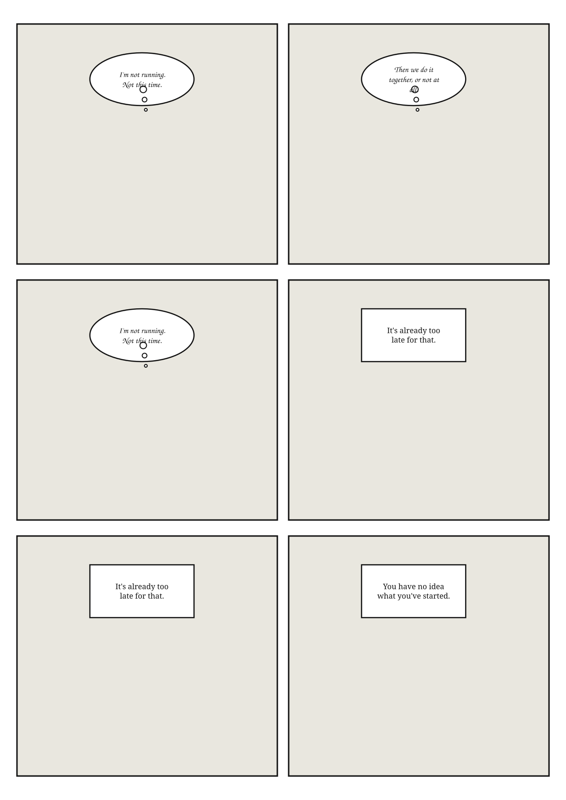

<!-- ╔══════════════════════════════════════════════════════════════════════╗ -->
<!-- ║  Replace this slot with a demo GIF of the editor once you record one.  ║ -->
<!-- ╚══════════════════════════════════════════════════════════════════════╝ -->
<p align="center">
  
</p>

<h1 align="center">MangaForge</h1>

<p align="center">
  <strong>Type a story idea. Get a fully drawn, laid-out, black-and-white manga chapter —
  then edit it panel by panel and export it.</strong>
</p>

<p align="center">
  <em>Runs end-to-end with <strong>zero API keys</strong> via a built-in mock artist.</em>
</p>

---

MangaForge is an AI manga studio. Give it a premise and a genre; it drafts a
story bible and cast, breaks the story into pages and panels, renders each panel
as monochrome manga art, and drops you into a Figma-like editor where panels,
speech bubbles, and SFX are all freely movable, with undo/redo over everything.
Export to PDF, CBZ, a PNG set, or a webtoon long-strip.

## Features

- **One-prompt pipeline** — premise → story bible → editable characters →
  page/panel script → rendered chapter, each step individually re-runnable.
- **Mock-first**: the whole app works offline with a deterministic mock provider.
  No keys, no cost, CI-green on a clean clone.
- **Character consistency** — a per-character reference sheet anchors every panel
  the character appears in.
- **Real Konva editor** — drag/resize panels with snapping; vector speech
  bubbles (speech, thought, shout, whisper, narration, off-panel, aside) with
  draggable tails; rotatable/scalable SFX; inline text editing; zoom/pan;
  safe-margin + reading-order overlays.
- **Per-panel AI tools** — regenerate, 4-up variations, natural-language edit
  ("make it raining"), and brush-mask inpaint, with version history + restore.
- **20+ layout templates** with correct **right-to-left** manga reading order
  (flips for LTR). Swapping a layout re-flows existing panels instead of nuking
  them.
- **6 style presets** + 8 one-click genre starters.
- **Undo/redo** (120 steps) over panel moves, text, bubbles, SFX, layout swaps,
  and regenerations. Debounced autosave.
- **Export**: PDF, CBZ (with ComicInfo + RTL flag), zipped PNG set, stitched
  webtoon JPEG, and a server-composed vector SVG page-set. Print-ready 300 DPI
  toggle.
- **Guardrails**: rejects franchise-character prompts and basic disallowed
  content with a clear message.
- **Cost containment**: per-IP rate limiting + a server-enforced daily panel cap,
  with remaining quota surfaced in the UI.

## Quickstart (zero keys)

```bash
pnpm install
pnpm dev
# open http://localhost:3000 — click "New Manga", pick a starter, Generate.
```

That's it. With no `.env.local`, MangaForge uses the **mock provider** (SVG
placeholder panels) and the **mock story generator** (deterministic bible +
script). Every screen is fully usable.

Want the committed sample chapter in your library too?

```bash
pnpm db:seed     # inserts a demo project and (re)writes /public/seed art
```

## Turn on real AI

Copy the example env and fill in what you want:

```bash
cp .env.example .env.local
```

```env
ANTHROPIC_API_KEY=sk-ant-...     # story bible + script via Claude (optional)
IMAGE_PROVIDER=gemini            # mock | gemini | fal
GOOGLE_API_KEY=...               # if IMAGE_PROVIDER=gemini
FAL_KEY=...                      # if IMAGE_PROVIDER=fal
```

Restart `pnpm dev`. Now a premise typed on `/new` produces a real illustrated
chapter. **No key ever reaches the browser** — every AI call runs in a route
handler, and `pnpm check:secrets` fails the build if a key-shaped string sneaks
into the client bundle.

### Image provider comparison

| Provider | Env | Strengths | Use when |
|---|---|---|---|
| **`mock`** (default) | none | Instant, free, deterministic SVG placeholders. | Local dev, CI, demos, offline. |
| **`gemini`** | `GOOGLE_API_KEY` | Best multi-reference character consistency + natural-language edits (`gemini-2.5-flash-image`). | You want the best character consistency. |
| **`fal`** | `FAL_KEY` | Flux text-to-image + Flux Kontext image-conditioned edit/inpaint. | Solid, fast fallback. |

Adding your own provider is a ~40-line file — see [CONTRIBUTING.md](CONTRIBUTING.md).

## Deployment

MangaForge deploys anywhere Next.js 15 runs (Vercel, Fly, a container). Two
things need external services on serverless hosts because their filesystem is
read-only/ephemeral:

**Database** — `DATABASE_URL` accepts a local SQLite file *or* a remote
[Turso](https://turso.tech) libSQL URL with no code change:

```env
DATABASE_URL=libsql://your-db.turso.io
DATABASE_AUTH_TOKEN=...
```

**Storage** — set `STORAGE_ADAPTER=s3` for any S3-compatible bucket
(Cloudflare R2, Backblaze B2, MinIO):

```env
STORAGE_ADAPTER=s3
S3_ENDPOINT=https://<accountid>.r2.cloudflarestorage.com
S3_BUCKET=mangaforge
S3_ACCESS_KEY_ID=...
S3_SECRET_ACCESS_KEY=...
S3_PUBLIC_URL=https://cdn.example.com   # optional public base
```

For a purely local run, the defaults (`file:` SQLite + `local` storage) are all
you need. Generated art is written to `/public/generated` (gitignored).

### Cost containment (public deploys)

Because image generation costs money, all generation routes are protected:

```env
MAX_PANELS_PER_DAY=200      # server-enforced daily cap (per hashed IP + day)
MAX_PAGES_PER_CHAPTER=24    # hard chapter-length cap
REDIS_URL=                  # optional: Upstash Redis REST for distributed limits
UPSTASH_REDIS_REST_URL=
UPSTASH_REDIS_REST_TOKEN=
```

Without Redis, rate limiting uses an in-memory sliding window.

## Scripts

| Command | What it does |
|---|---|
| `pnpm dev` | Dev server (mock provider by default). |
| `pnpm build` / `pnpm start` | Production build / serve. |
| `pnpm typecheck` | `tsc --noEmit`. |
| `pnpm lint` | ESLint. |
| `pnpm test` | Vitest unit tests. |
| `pnpm db:generate` | Generate Drizzle migrations. |
| `pnpm db:migrate` | Create tables (idempotent). |
| `pnpm db:seed` | Seed a demo project + write `/public/seed` art. |
| `pnpm check:secrets` | Scan the built client bundle for leaked keys. |

## Environment reference

See [`.env.example`](.env.example) for the full list. Nothing sensitive uses a
`NEXT_PUBLIC_` prefix.

## Screenshots

> Add screenshots here: the dashboard, the creation wizard, the editor (canvas +
> inspector), and the reader. The `/public/seed` SVGs show the mock art style.

## Extending

The three most common extensions each have a worked example in
[CONTRIBUTING.md](CONTRIBUTING.md):

- **Add a layout template** → `src/lib/layouts.ts`
- **Add a style preset** → `src/lib/styles.ts`
- **Add an image provider** → `src/lib/providers/`

## Tech stack

Next.js 15 (App Router, React 19) · TypeScript (strict) · Tailwind v4 ·
Drizzle ORM on libSQL/SQLite · Konva / react-konva · Zustand + zundo ·
TanStack Query · Zod · jsPDF · JSZip · p-limit.

## License

[MIT](LICENSE). See [NOTICE.md](NOTICE.md) for content, ownership, and font
attributions, and [DECISIONS.md](DECISIONS.md) for design trade-offs.
